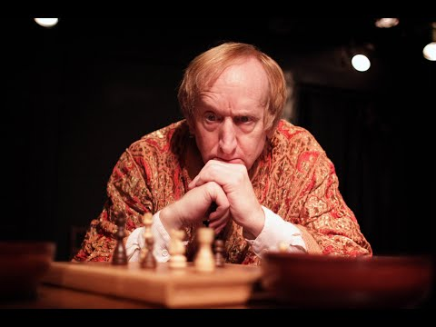

- Read the [Course Syllabus](https://seaxelrod.github.io/BOLLI-f26-tales-of-defiance/DMC_preface.html)
- Read the [Preface to the Course](https://seaxelrod.github.io/BOLLI-f26-tales-of-defiance/DMC_preface.html), which consists of sections:
   1. Genesis of the Course:  Getting Perspective on Mind Control
   2. Shaping the Container
   3. What We Will Be Exploring
   4. An Arc of Stories and Lenses
	   -  You may delay reading the parts on the tales for weeks 2, 3, and 4, which will be repeated as part of the notes on the tale of the week.
- Read the [Notes on *Notes from the Underground*](https://seaxelrod.github.io/BOLLI-f26-tales-of-defiance/DMC_notes_on_notes.html).
    - This contains a section titled "Tale 1: Notes from the Underground", which exactly repeats the subsection by that name in section 4 of the preface.
- Watch ["Notes from the Underground", one man show starring Larry Cedar, free on YouTube](https://www.youtube.com/watch?v=asp5tqDql0g). 
    {width=50%}  <!-- image from https://img.youtube.com/vi/asp5tqDql0g/hqdefault.jpg -->

## Here are some questions that may help guide your reflection as you do the homework:

<!-- taken from Claude [Play for Talkes of Defiance to Mind Control -> Discussion questions for defiance and mind control course] -->

### Relating to the [Course Preface](DMC_preface.html)

- What do we mean by "mind control"? Where's the line between influence, persuasion, socialization, and control?
- Is there such a thing as a truly autonomous, un-conditioned self? Or is the "authentic self" we want to protect also a social construction?
- Why might fiction be a better tool than a lecture or essay for helping us *feel* what mind control is like from the inside?
- As we move across these four works, control shifts from external force to something we welcome. Does control become more effective as it becomes more comfortable?
- What personality traits make someone more or less susceptible to each kind of control? Where would you place yourself?

#  Relating to human outlier analysis

- How is the protagonist unusual in the society in which they live, and how are they trying to influence that society? 
- Do you sympathize with the protagonist and his plight? What about the other characters?
- Can we usefully separate out the dysfunction from the creative insight?
- What does the protagonist see about society that those around him do not see?

### Specific to [Notes from the Underground](DMC_notes_on_notes.html)

- The Underground Man rejects the idea that humans are rational actors. Why does he insist on the freedom to act against his own interest? Is spite a form of liberty?
- Are feeling and complexity suppressed by naive rationalism?   
- Is rationalism actually a form of mind control, or is that a misdiagnosis? 
- Who decides which people in society are outliers to be shunned,  which thoughts are "crazy" and which are sane? 
- The Underground Man is miserable, self-sabotaging, and often unlikable. Does his defiance actually free him, or does it just trap him in a different prison?
- When is being unhinged and spiteful a useful choice in a modern democracy?
- The Underground Man is struggling to escape from his mousehole.  He resents "2+2=4" logic being forced on him, but he is trapped into
   incessant, intelectualized monologuing from within his cave (mousehole).
   Are love and faith of some kind the best ways to escape the cave of rational egoism?

###  Connecting "Notes from the Underground" to today's world of AI and social media

- The Underground Man rebels against being treated as a predictable input-output machine. 
   Recommendation engines and predictive analytics treat us exactly that way—as behavior to be forecast. 
   Is refusing to be predictable still a meaningful act of freedom when the algorithm has already modeled your refusal?
- Where in your own online life do complexity and messiness get suppressed in favor of a cleaner, curated, presentable self?
- Educational, religious, and other institiutions have traditionally set norms of what thoughts and actions are acceptable. Outliers have been sent to prisons and mental asylums.
  How are those roles evolving in today's age of social media and AI?

