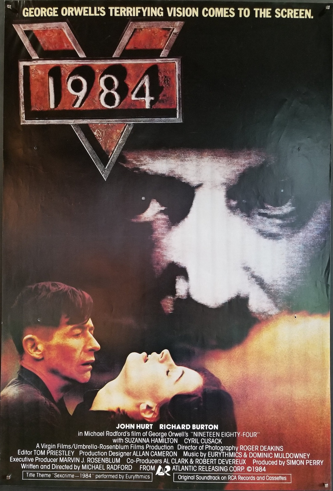

- Watch ["1984" movie directed by Michael Radford](https://archive.org/details/1984-1984_202511).
  {width=10% style="vertical-align: middle;"}

- Read (or reread) the [Preface Section on *1984*,  Disciplinary Surveillance,  and Narrative Analysis](DMC_preface.html#tale-2-1984).

- Read the [Afterword to the 1961 Signet edition of *1984*, by Eric Fromm](https://five.sh/files/pdf/Literature/Erich%20Fromm%20-%20AFTERWORD%20to%20George%20Orwells%201984.pdf).
  - Here is a [copy on the course website](materials/1984/1984_afterword_by_ErichFromm.pdf).
  - If this is too verbose, you may read instead, the [Claude AI Summary of Fromm's Afterword](materials/1984/1984_references_and_info.html#claude-ai-summary-of-fromms-afterword).

- Extra Credit:  Send me a link to an article about recent world events that mentions (or very well could mention) 
                        George Orwell, the book *1984*, or related terms.
                       If you like, give a brief description of the article and/or how Orwellian concepts come up.
                       I will compile all of the responses and send them out on Sunday, Nov. 8, the day before the next class.
					   I will also put the compilation on our website.
					   I will credit contributors by first name only, unless they mention they prefer to be anonymous.

- Double Extra Credit:   Browse the link to our website [References and Info for Week 2: 1984](materials/1984/1984_references_and_info.html).
   The link to this (at the end of the last sentence) can be found on the page of our website obtained by clicking on the dropdown [References and Info](materials/DMC_references_and_info.html).

## Questions to Guide Reflection

### Questions in [Preface Section on *1984*,  Disciplinary Surveillance,  and Narrative Analysis](DMC_preface.html#tale-2-1984)

-  *Mental control often attempts to flatten a person’s inner life. How does the narrative use the "intentional states" (private thoughts) of the characters to defy the external world?*
- *In a "mentally controlled world," the system provides the "canonical script" (how one should think and act). How does the protagonist of our story create a "breach" in that script?*
- *In propaganda-heavy worlds, "truth" is whatever the state says. How does a "tale of defiance" use "narrative truth" to expose the lies of "systemic truth"?*
- *Why do we often use the "Dystopian" genre to talk about mental control? How does the genre itself help us understand what "defiance" looks like?*
- *What helps or hurts the ability  of individual acts of defiance "accrue" into a movement?*

### Questions following up on Fromm's Afterword

- *Can the longing for freedom be extinguished, or does human nature push back, as a defiance to mind control?*  
   In words that turn [O'Briens statement of power](https://archive.org/details/1984-1984_202511?start=5453) into a question:

   > *Can a boot stamp on a human face forever?*

- *Does the severity of the methods used by the state prove the strength of what they suppress?*  
   *Do severe methods actually increase the stength of the defiant?*  

- [Is history really written by the victors?](https://historylearning.com/blog/is-history-really-written-by-the-victors/)  
   *Is truth written by those in power?*

