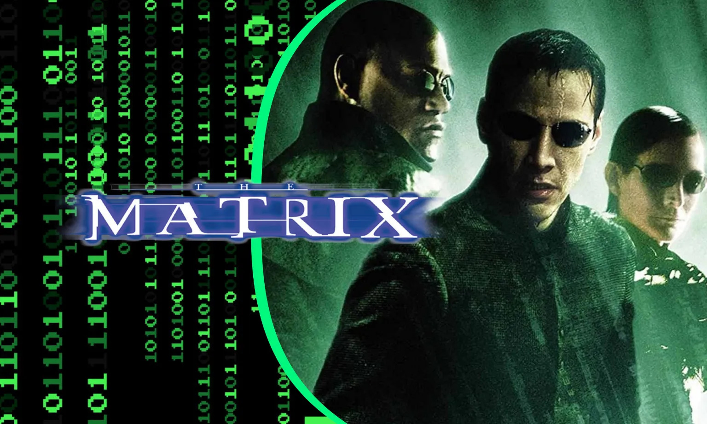

#### 1.  Watch *The Matrix* movie, written and directed by the Wachowskis, 2h16m

- [$3.99 to rent on YouTube.  Need to create a free YouTube login.](https://www.youtube.com/watch?v=GuE0Mtr-w6g)
- [$3.99 to rent, $14.99 to buy on Amazon Prime Video.  Need an Amazon Prime account.](https://www.amazon.com/gp/video/detail/B0B6DB8G7C/ref=atv_dp_amz_c_yxuuUK_1_1)

{width=50%} <!-- Image from: https://facts.net/wp-content/uploads/2023/06/47-facts-about-the-movie-the-matrix-1687246419.jpg -->

#### 2. Read the essay ["The Comfortable Prison: The Matrix and the Philosophers"](mind_control_3/the_matrix_and_the_philosophers.html)

#### 3. [optional] Read the essay ["No One Is Coming: The Matrix and the Rest of Us"](mind_control_3/the_matrix_and_the_rest_of_us.html)

#### 4. [optional] Read the essay ["Elon Musk Brings Simulation Theory to Joe Rogan"](mind_control_3/simulation_rogan_musk.html)

If you're going to pick just one of the two optional essays above to look at, 
I'd suggest the secod one. It follows a 2018 conversation between Joe Rogan and Elon Musk about whether we might be living in a computer simulation, and it looks at how that idea has made its way out of the philosophy seminar and into everyday culture. It's built around quotes from the show, with links to the moments in the video, so it reads more like a conversation than a philosophy lesson.

## Questions to Guide Reflection

### Questions in [Preface Section on *The Matrix* , Analysis of Societal Control](DMC_preface.html#tale-2-the-matrix))

1. Who or what is controlling society?
2. How is it being controlled?

### Questions in [The Comfortable Prison: The Matrix and the Philosophers](mind_control_3/the_matrix_and_the_philosophers.html)

1. Where does the film fit in our arc?
2. Who or what is controlling society, and how?
3. What does defiance look like when control no longer feels like control?
4. Am I contributing to, or being swept up in, our collectively "checking out"? 
5. Do those who would give up essential Freedom, to purchase a little temporary Comfort, deserve either Freedom or Comfort?
6. If there is no red pill, what are the rest of us supposed to do? 
7. Baudrillard says there is no "real world" to wake up into. Is he right, or is there still something real underneath the simulation?
8. The film keeps Plato's structure of a real world behind the illusion. Is that a flaw, as Baudrillard thought, or a strength?
9. Is Deleuze's picture of control, modulation without walls, a better description of our world than Orwell's Big Brother? Or do we live with both?

### Questions in [No One Is Coming: The Matrix and the Rest of Us](mind_control_3/the_matrix_and_the_rest_of_us.html)

1. If there is no red pill, what are the rest of us supposed to do? 
2. In all of these stories, isn't the essence of the struggle maintaining, or finding, one's own humanity? 
3. **Fear or desire?** Which controls you more these days: the news that frightens you, or the screens that please you? Can you tell them apart?
4. **Your own Cypher moments.** When have you chosen the comfortable version of things, knowing it wasn't quite real? Was that always a bad choice?
5. **What keeps you human?** What do you do, or refuse to do, that a system built to predict and please you would have trouble absorbing?
6. **Waiting for a savior.** Do you find yourself hoping for a leader, a technology, or an event that will fix things? What would it mean to give up that hope without giving up?
7. **Circuit breakers.** What are yours? A walk without your phone, a conversation with someone who disagrees with you, a book nobody recommended?

### Questions in  ["Elon Musk Brings Simulation Theory to Joe Rogan"](mind_control_3/simulation_rogan_musk.html)

1. Rogan pushes back once ("we're on our way to [a simulation]") and Musk concedes immediately. Why do you think the concession didn't stick — in the conversation or in the culture?
2. Rogan reads mason jars and raw wood as people "clinging" to reality. Do you see that longing in your own life or your children's and grandchildren's? Is the craft-and-vintage world a resistance to the virtual, or just another product of it?
3. In *The Matrix*, the real world is harsh but worth choosing. In Musk's telling, it is merely boring. Which picture is more dangerous to believe?
4. Does believing we might be in a simulation make a person more passive, or less? What would Dostoevsky's Underground Man say to Musk?
